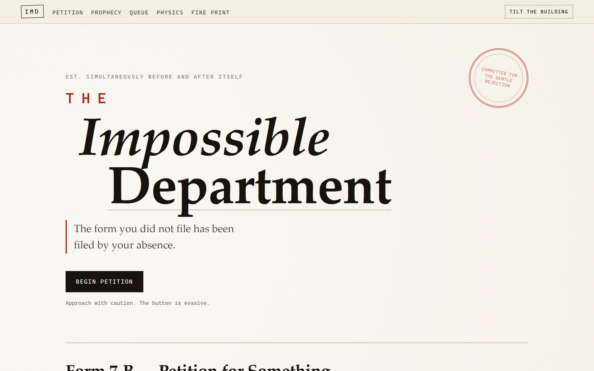
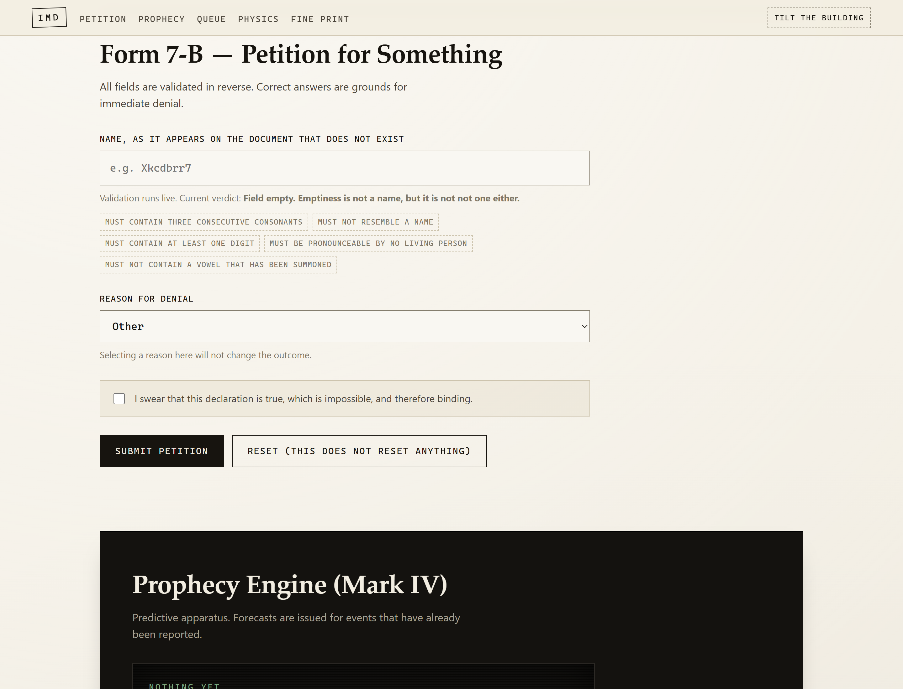
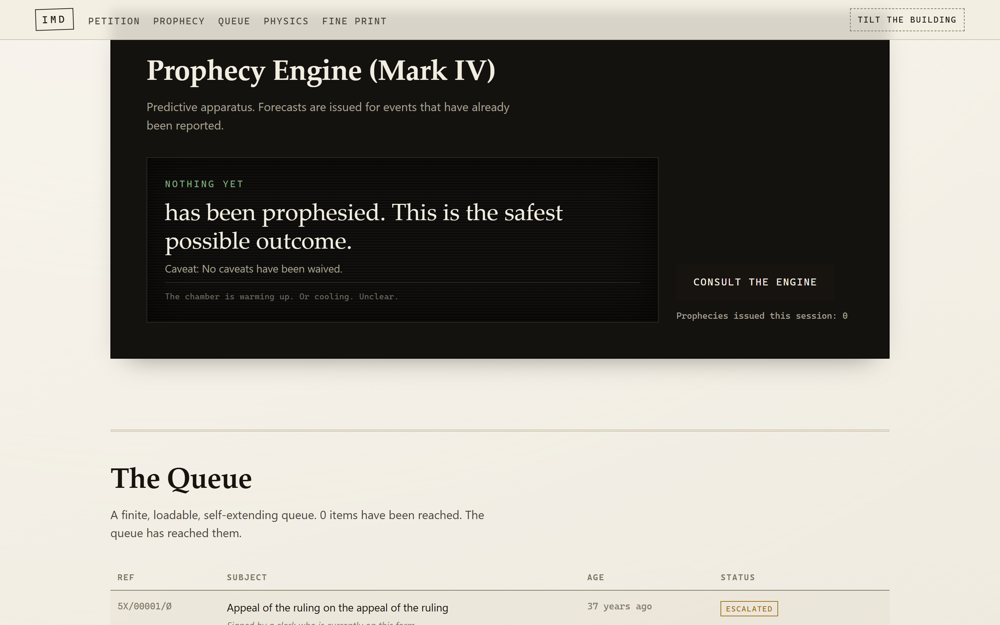
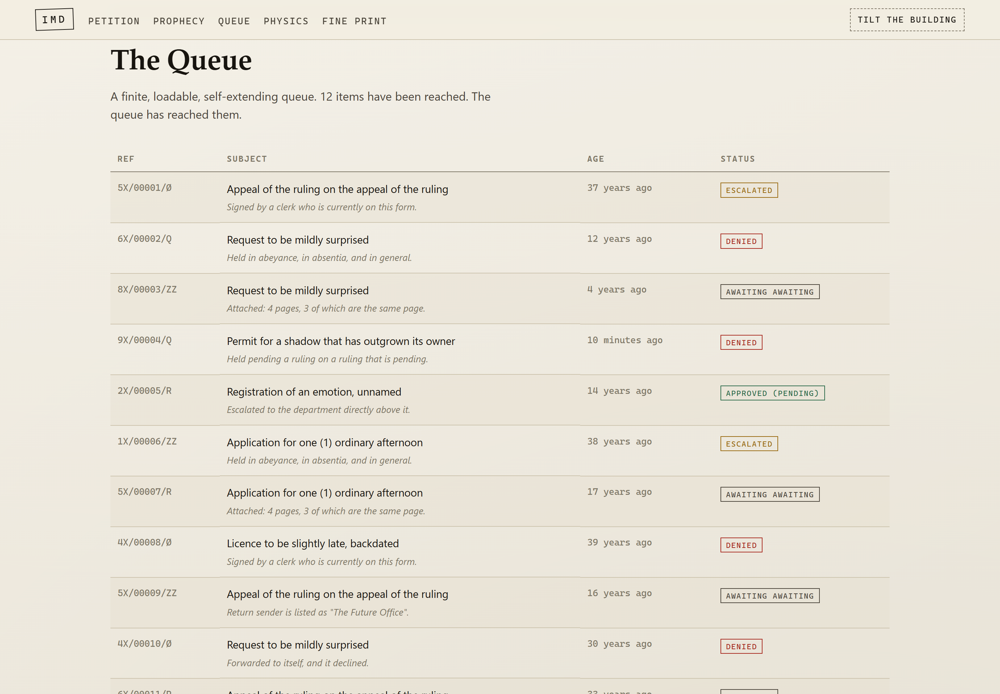
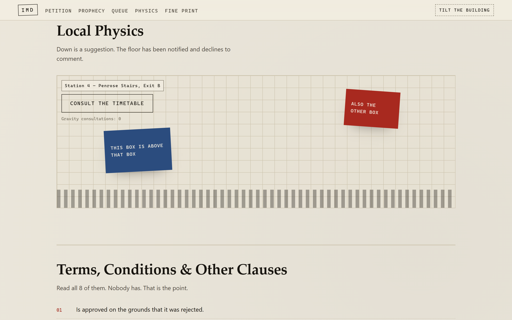
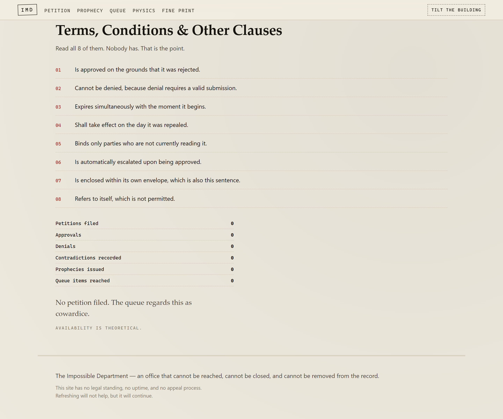
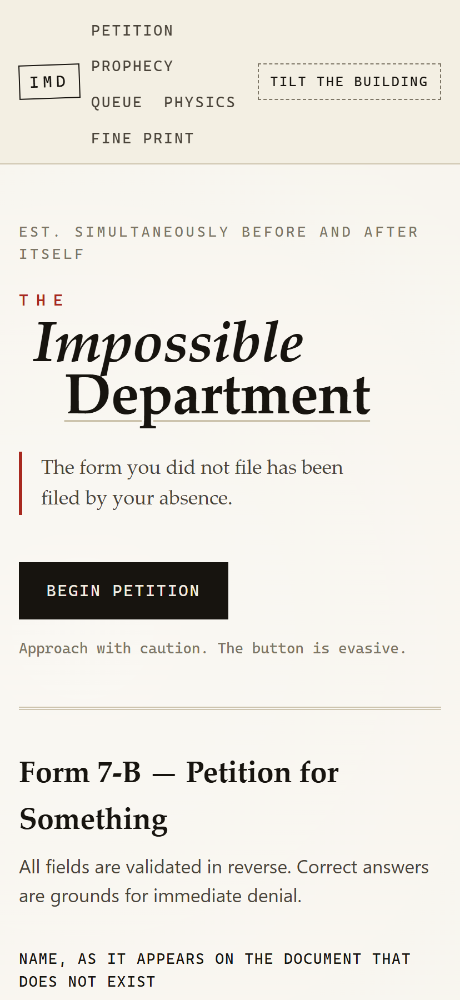
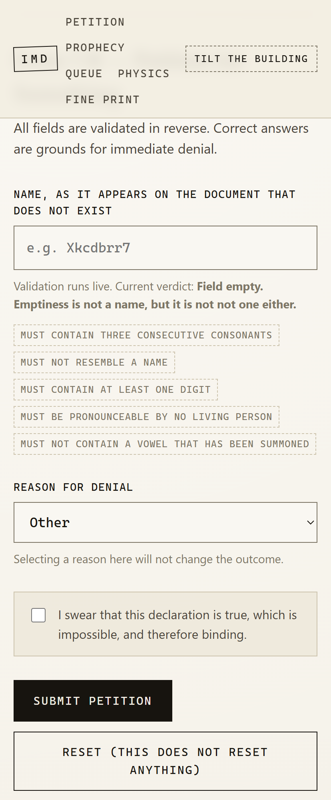

# The Impossible Department

> An office that cannot be reached, cannot be closed, and cannot be removed from the record.

[](https://github.com/TanimowoObaloluwaDavid/impossible-department/actions/workflows/deploy.yml)

**Live site:** https://tanimowoobaloluwavid.github.io/impossible-department/

A deliberately hostile single-page site built around backwards logic. Nothing here
refuses to work because of a bug — the refusals are the feature, and each section
violates a different rule on purpose.



---

## The premises

Three rules govern the whole site, and they are enforced rather than suggested:

**1. Correct answers are grounds for rejection.** Form 7-B validates names in
reverse. Type something legible and you are denied for being legible; type
compliant nonsense and it enters the record. The rules are published in the form
itself, so you can read exactly why you were turned away.

**2. Progress never resolves.** The queue loads forever, and the progress bar
caps at 97% and jitters rather than completing. Retrieving position 0 is the
stated task.

**3. Results arrive before the cause.** Submitting a petition can return
`ERR-0000 — Success. Success is unavailable.`, and the stamp reads `BOTH`.

## The sections

### Form 7-B — Petition for Something

Name validation runs live on every keystroke in `src/lib/validate.ts`. A submission
is accepted only if it is illegible: it must contain a digit, a run of three or more
consonants, and at least one vowel, and it must not look like a real name. Roughly a
third of otherwise-valid nonsense is rejected anyway because the Department
reconsiders mid-keystroke.

Try `Xkcdbr7a` for a clean pass, or `John Smith` to see it fail three ways at once.



### Prophecy Engine (Mark IV)

Forecasts events that have already been reported, with caveats that void
themselves on being read aloud and certificates witnessed by a pigeon employed
since 1974. Deterministic per seed, so the same chamber keeps issuing the same
prophecies.



### The Queue

An infinite table loaded through `IntersectionObserver` in 12-row pages. Each row
carries a reference code, an age measured in decades, and a status such as
`AWAITING AWAITING` or `APPROVED (PENDING)`. Scrolling for more always works; there
is always more.



### Local Physics

Pointer position drives a 3D tilt across the whole frame. Two boxes occupy the same
region and disagree about which is above the other. A timetable offers five
destinations, none of which are floors.



### Terms, Conditions & Other Clauses

Eight self-referential clauses, a live session tally, and a verdict derived from
what you actually submitted.



## Also included

A **Tilt the building** control in the nav rotates the entire document by 1.4
degrees, which is the most the building will allow.

Mobile is supported. The layouts hold at 414px, the rotation stamp steps aside, and
the queue scrolls horizontally rather than collapsing:

| Hero | Form 7-B |
| --- | --- |
|  |  |

## Stack

| | |
| --- | --- |
| Framework | React 19 + Vite 8 |
| Language | TypeScript, `strict`, `verbatimModuleSyntax` |
| Linting | `oxlint` |
| Runtime deps | React only |
| Randomness | Seeded PRNG in `src/lib/rng.ts` |

The PRNG is seeded rather than `Math.random`, so the bureaucracy is reproducible
across sessions. That makes any bug chaseable and lets you reproduce a specific run
by replaying its seed.

## Project layout

```
src/
  App.tsx                 section composition, building-tilt state
  App.css                 all component styling
  components/
    Hero.tsx              rotating taglines, the button that flees the cursor
    PetitionForm.tsx      Form 7-B and its reversed validation
    ProphecyEngine.tsx    seeded prophecy generation
    QueueBoard.tsx        infinite scroll, capped progress bar
    PhysicsPanel.tsx      pointer-driven 3D tilt
    FinePrint.tsx         clauses, session tally, verdict
  data/bureau.ts          all copy, rules, error codes, queue items
  lib/
    rng.ts                seeded PRNG: makeRng, pick, shuffle
    stats.ts              session counters via useSyncExternalStore
    validate.ts           the reverse name validator
scripts/
  screenshots.mjs         captures docs/*.png via headless Chrome + CDP
  audit.mjs               headless assertions over the built site
```

## Development

```bash
npm install
npm run dev      # dev server
npm run lint     # oxlint
npm run build    # tsc -b && vite build
npm run preview  # serve the production build
```

## Verifying it works

`scripts/audit.mjs` drives headless Chrome over the DevTools protocol and asserts
the built site actually renders: React mounts, CSS applies, every section has real
geometry and text, the reverse validator rejects `John Smith` while accepting
`Xkcdbr7a`, submitting produces an outcome, the queue loads rows past the first
page, and no screenshot is blank.

```bash
npm run build
node scripts/audit.mjs      # exits non-zero on failure
node scripts/screenshots.mjs  # regenerate docs/*.png
```

Both scripts are dependency-free — Node 22+ ships a global `WebSocket`, and Chrome
exposes the CDP endpoint on localhost. Neither needs a dev server.

This is how the placeholder bug was caught: the audit failed on a form example that
contained no vowel, so the site was suggesting a name its own rules reject. Worth
running the audit after any change to the validation rules.

## Deployment

`.github/workflows/deploy.yml` lints, builds, and publishes to GitHub Pages on every
push to `main`. Vite's `base` is `./`, so the build works from any path — user and
organization Pages included.